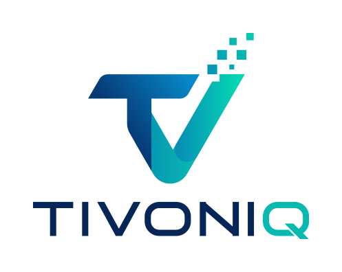
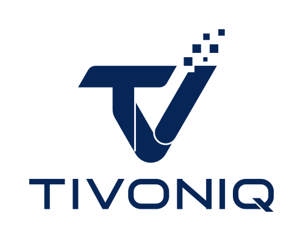
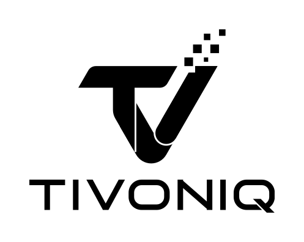
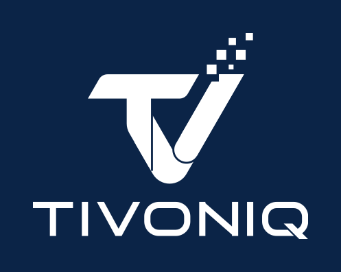
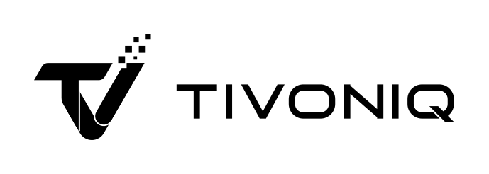
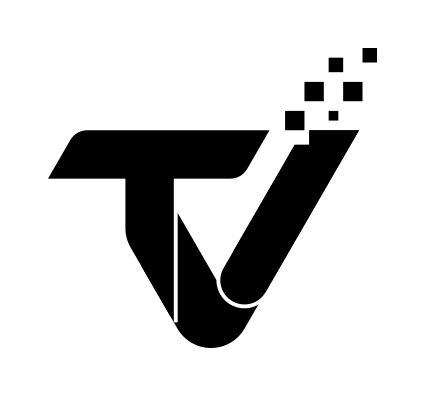
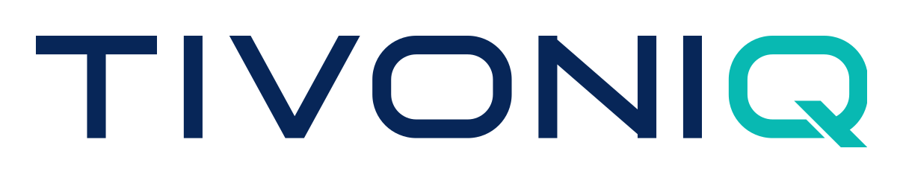
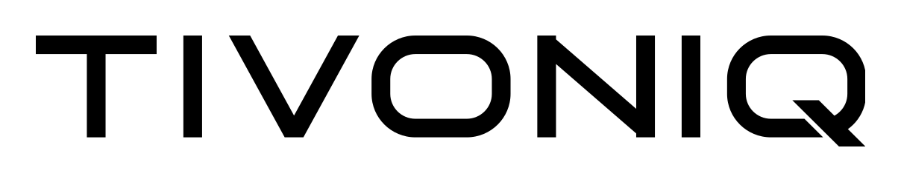
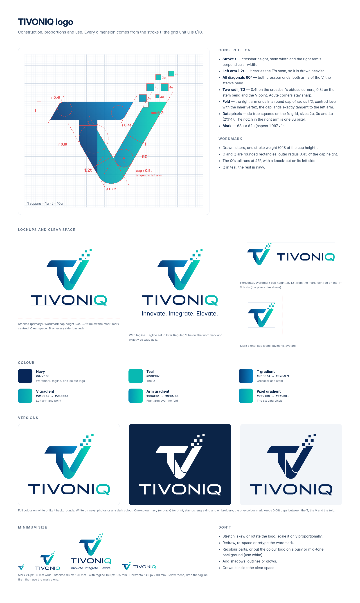

# TIVONIQ brand: logo

<p align="center"></p>

The official TIVONIQ logo, redrawn as clean vector geometry. Every file in this repo comes from one script: the proportions, angles, radii and colours are defined once in [`src/build_logo.py`](src/build_logo.py) and every SVG, PNG and the guidelines sheet is generated from it.

**Quick links:** [All SVGs](logo/svg) · [All PNGs](logo/png) · [Guidelines (PDF)](guidelines/TIVONIQ-logo-guidelines.pdf)

## Contents

- [All versions](#all-versions)
- [Which file to use](#which-file-to-use)
- [Construction](#construction)
- [Proportions and lockups](#proportions-and-lockups)
- [Clear space and minimum size](#clear-space-and-minimum-size)
- [Colour](#colour)
- [Do and don't](#do-and-dont)
- [Files](#files)
- [Rebuilding](#rebuilding)
- [Usage](#usage)

## All versions

Five layouts, each in four colourways. Every image links to its SVG; PNGs (transparent background) are in [`logo/png`](logo/png). The white versions are shown on navy so they are visible here; the files themselves are transparent.

### Stacked (primary)

Mark above the wordmark. The default logo.

| Full colour | Navy | Black | White |
|---|---|---|---|
| <a href="logo/svg/tivoniq-stacked-color.svg"></a> | <a href="logo/svg/tivoniq-stacked-navy.svg"></a> | <a href="logo/svg/tivoniq-stacked-black.svg"></a> | <a href="logo/svg/tivoniq-stacked-white.svg"></a> |
| [SVG](logo/svg/tivoniq-stacked-color.svg) · [PNG](logo/png/tivoniq-stacked-color.png) | [SVG](logo/svg/tivoniq-stacked-navy.svg) · [PNG](logo/png/tivoniq-stacked-navy.png) | [SVG](logo/svg/tivoniq-stacked-black.svg) · [PNG](logo/png/tivoniq-stacked-black.png) | [SVG](logo/svg/tivoniq-stacked-white.svg) · [PNG](logo/png/tivoniq-stacked-white.png) |

### Stacked with tagline

With *Innovate. Integrate. Elevate.* Use where there is room for the tagline to stay legible.

| Full colour | Navy | Black | White |
|---|---|---|---|
| <a href="logo/svg/tivoniq-stacked-tagline-color.svg"></a> | <a href="logo/svg/tivoniq-stacked-tagline-navy.svg"></a> | <a href="logo/svg/tivoniq-stacked-tagline-black.svg"></a> | <a href="logo/svg/tivoniq-stacked-tagline-white.svg"></a> |
| [SVG](logo/svg/tivoniq-stacked-tagline-color.svg) · [PNG](logo/png/tivoniq-stacked-tagline-color.png) | [SVG](logo/svg/tivoniq-stacked-tagline-navy.svg) · [PNG](logo/png/tivoniq-stacked-tagline-navy.png) | [SVG](logo/svg/tivoniq-stacked-tagline-black.svg) · [PNG](logo/png/tivoniq-stacked-tagline-black.png) | [SVG](logo/svg/tivoniq-stacked-tagline-white.svg) · [PNG](logo/png/tivoniq-stacked-tagline-white.png) |

### Horizontal

Mark beside the wordmark, for headers, letterheads, banners and narrow strips.

| Full colour | Navy | Black | White |
|---|---|---|---|
| <a href="logo/svg/tivoniq-horizontal-color.svg"></a> | <a href="logo/svg/tivoniq-horizontal-navy.svg"></a> | <a href="logo/svg/tivoniq-horizontal-black.svg"></a> | <a href="logo/svg/tivoniq-horizontal-white.svg"></a> |
| [SVG](logo/svg/tivoniq-horizontal-color.svg) · [PNG](logo/png/tivoniq-horizontal-color.png) | [SVG](logo/svg/tivoniq-horizontal-navy.svg) · [PNG](logo/png/tivoniq-horizontal-navy.png) | [SVG](logo/svg/tivoniq-horizontal-black.svg) · [PNG](logo/png/tivoniq-horizontal-black.png) | [SVG](logo/svg/tivoniq-horizontal-white.svg) · [PNG](logo/png/tivoniq-horizontal-white.png) |

### Mark

The T/V mark alone: app icons, favicons, avatars, social profile pictures.

| Full colour | Navy | Black | White |
|---|---|---|---|
| <a href="logo/svg/tivoniq-mark-color.svg"></a> | <a href="logo/svg/tivoniq-mark-navy.svg"></a> | <a href="logo/svg/tivoniq-mark-black.svg"></a> | <a href="logo/svg/tivoniq-mark-white.svg"></a> |
| [SVG](logo/svg/tivoniq-mark-color.svg) · [PNG](logo/png/tivoniq-mark-color.png) | [SVG](logo/svg/tivoniq-mark-navy.svg) · [PNG](logo/png/tivoniq-mark-navy.png) | [SVG](logo/svg/tivoniq-mark-black.svg) · [PNG](logo/png/tivoniq-mark-black.png) | [SVG](logo/svg/tivoniq-mark-white.svg) · [PNG](logo/png/tivoniq-mark-white.png) |

### Wordmark

TIVONIQ alone, where the mark already appears nearby.

| Full colour | Navy | Black | White |
|---|---|---|---|
| <a href="logo/svg/tivoniq-wordmark-color.svg"></a> | <a href="logo/svg/tivoniq-wordmark-navy.svg"></a> | <a href="logo/svg/tivoniq-wordmark-black.svg"></a> | <a href="logo/svg/tivoniq-wordmark-white.svg"></a> |
| [SVG](logo/svg/tivoniq-wordmark-color.svg) · [PNG](logo/png/tivoniq-wordmark-color.png) | [SVG](logo/svg/tivoniq-wordmark-navy.svg) · [PNG](logo/png/tivoniq-wordmark-navy.png) | [SVG](logo/svg/tivoniq-wordmark-black.svg) · [PNG](logo/png/tivoniq-wordmark-black.png) | [SVG](logo/svg/tivoniq-wordmark-white.svg) · [PNG](logo/png/tivoniq-wordmark-white.png) |

## Which file to use

| Situation | File |
|---|---|
| Website, documents, presentations on white or light backgrounds | `tivoniq-stacked-color` or `tivoniq-horizontal-color` |
| Dark backgrounds, photos, navy | `-white` |
| One-colour print, stamps, engraving, laser cutting, embroidery, fax | `-navy` or `-black` |
| App icon, favicon, avatar | `tivoniq-mark-color` (on a white or light tile) |
| Business cards, brochures, posters (with room) | `tivoniq-stacked-tagline-color` |
| Website header, email signature, letterhead | `tivoniq-horizontal-color` |

Use **SVG** wherever the software accepts it (web, Figma, Illustrator, Inkscape, print shops). Use the **PNG**s (transparent, 2400 px wide; marks 1024 px) for Word, PowerPoint, WhatsApp and similar.

## Construction

<p align="center"></p>

Every dimension derives from the stroke **t**. The grid unit **u = t / 10**.

| Element | Rule |
|---|---|
| Stroke **t** | Crossbar height = stem width = perpendicular width of the V's right arm |
| Left arm | **1.2t** perpendicular: it carries the T's stem, so it is drawn heavier |
| Angles | Every diagonal is **60°**: both crossbar ends, both arms of the V, the stem's bend |
| Corner radii | Two only, ratio 1:2. **0.4t** on the crossbar's obtuse corners, **0.8t** on the stem bend and the V point. Acute corners stay sharp |
| Fold | The right arm ends in a round cap of radius **t/2**, centred level with the V's inner vertex. The cap lands exactly tangent to the left arm's inner edge |
| Data pixels | **Six true squares** on the 1u grid, sizes **2u, 3u, 4u** (2:3:4). Three 4u, two 3u, one 2u |
| Notch | One **3u** pixel bitten out of the right arm's inner top corner; the nearest 4u pixel sits one unit away |
| Mark size | **68u × 62u** (aspect 1.097 : 1) |
| One-colour mark | **0.08t** knock-out gaps between the T and the V and around the fold, so the parts stay readable without colour |

### Wordmark

- Drawn letters, not a font: one stroke weight, 0.18 of the cap height.
- **O** and **Q** are rounded rectangles, outer radius 0.43 of the cap height.
- **V** has a flat foot exactly one stroke wide; the **N** diagonal runs corner to corner.
- The **Q** tail runs at **45°** and ends level with half a stroke below the baseline; a thin knock-out separates it from the bowl on its left.
- Letter gaps are equal, except V–O, which is tightened optically.
- **Q** in teal, the rest in navy.

### Tagline

*Innovate. Integrate. Elevate.* is set in [Inter](https://rsms.me/inter/) Regular (single-storey a), converted to outlines, and stretched to exactly the wordmark's width.

## Proportions and lockups

| Lockup | Wordmark cap height | Spacing |
|---|---|---|
| Stacked | 1.4t | 0.75t between the mark and the wordmark; mark centred over the wordmark |
| Stacked + tagline | 1.4t | Tagline 1t below the wordmark baseline, same width as the wordmark |
| Horizontal | 2t | 1.5t between the mark and the wordmark; wordmark centred on the T–V body (the pixels rise above it) |

Aspect ratios of the files (width : height):

| File | Ratio |
|---|---|
| Mark | 1.097 : 1 |
| Stacked | 1.34 : 1 |
| Horizontal | 3.95 : 1 |

Never stretch: scale only proportionally (hold Shift, or lock the aspect ratio).

## Clear space and minimum size

**Clear space: 2t on every side** (t = the crossbar height in the size you are using, about 1/6 of the mark's height). Keep text, other logos and the edge of the page out of it.

| Version | Minimum width (screen) | Minimum width (print) |
|---|---|---|
| Mark | 24 px | 6 mm |
| Stacked | 96 px | 20 mm |
| Stacked + tagline | 160 px | 35 mm |
| Horizontal | 140 px | 30 mm |

Below these sizes, drop the tagline first, then use the mark alone.

## Colour

| Name | Value | Used for |
|---|---|---|
| Navy | `#072658` | Wordmark, tagline, one-colour logo |
| Teal | `#08B9B2` | The Q |
| T gradient | `#063874` → `#078AC9` | Crossbar and stem (deep navy to blue) |
| V gradient | `#0598B2` → `#0BBBB2` | Left arm and the round point |
| Arm gradient | `#068EB5` → `#04D7B3` | Right arm, laid over the fold |
| Pixel gradient | `#0391B6` → `#05CBB1` | The six data pixels |
| Dark background | `#0B2447` | Recommended background for the white logo |

The gradient stops were fitted to the original artwork's pixels, so the redraw matches the logo already in use. Gradient directions are fixed in the SVGs; don't re-apply your own.

## Do and don't

**Do**
- Use the files as they are, on white/light (colour) or dark (white) backgrounds.
- Keep the clear space and the minimum sizes.
- Use one-colour navy or black where colour or gradients can't be reproduced.

**Don't**
- Stretch, skew, rotate or outline the logo.
- Redraw, re-space or retype the wordmark, or set "TIVONIQ" in another font as a logo.
- Recolour individual parts, or place the colour logo on busy or mid-tone backgrounds.
- Add shadows, glows, bevels or effects.
- Move, add or remove data pixels.

## Files

```
logo/
  svg/   tivoniq-<layout>-<colour>.svg   20 vector files (layout: mark, wordmark, stacked,
                                         stacked-tagline, horizontal; colour: color, navy, black, white)
  png/   same names, transparent PNG     2400 px wide (marks 1024 px)
guidelines/
  TIVONIQ-logo-guidelines.pdf            one-page guidelines sheet (construction, lockups, colour, sizes)
  TIVONIQ-logo-guidelines.png            the same as an image
previews/                                README thumbnails on a background (not for use)
src/
  build_logo.py                          the geometry: every dimension, colour and lockup rule
  build_guide.py                         the guidelines sheet
  build_all.sh                           rebuilds everything
```

All SVGs are plain paths with linear gradients (no fonts, no embedded images). The one-colour marks use an SVG mask for the knock-out gaps.

## Rebuilding

```bash
python3 -m venv .venv && . .venv/bin/activate
pip install -r requirements.txt
# put Inter.ttf in fonts/ (see fonts/README.md)
src/build_all.sh          # needs rsvg-convert, ImageMagick and Chromium
```

To change the logo, change the numbers in `src/build_logo.py` (stroke, radii, pixel positions, colours, lockup spacing) and rebuild; every file updates together.

## Usage

© TIVONIQ. The TIVONIQ name and logo are trademarks of TIVONIQ. These files are published so partners, press, clients and the team can use the logo correctly when referring to TIVONIQ. They are not licensed for any other use, and must not be modified or used to suggest endorsement without permission.
